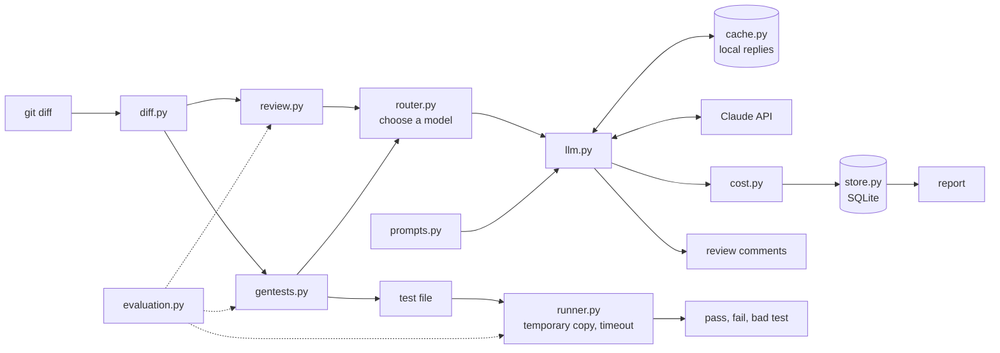

# PatchPilot

A Python CLI and GitHub Action that reviews a git diff with the Claude API, generates pytest tests
for the changed functions, runs them, and records the tokens and cost of every request.

**Status:** the code is complete and tested against a mocked API. It has not yet been run against
the real Claude API, so there are no benchmark results.

## Architecture



| Module | What it does |
|---|---|
| `diff.py` | Parses `git diff` output into files, hunks and numbered lines |
| `review.py` | Asks for review comments and drops any on files that were not sent |
| `gentests.py` | Finds changed functions with `ast` and asks for tests |
| `prompts.py` | Versioned prompts (`v1`, `v2`) and the text form of a diff |
| `llm.py` | One request: timeout, up to 2 retries, `max_tokens`, validated JSON, logging |
| `router.py` | Rules that pick the small or large model |
| `cache.py` | Local reply cache and prompt cache markers |
| `cost.py`, `store.py` | Price calculation and the SQLite request log |
| `runner.py` | Runs a test file on a temporary copy of the code and judges the results |
| `evaluation.py` | The seeded-bug evaluation |
| `cli.py`, `config.py` | Commands and settings |

## Install

Requires Python 3.11 or newer and git.

Windows (PowerShell):

```powershell
python -m venv .venv
.\.venv\Scripts\Activate.ps1
python -m pip install -e ".[dev]"
```

macOS or Linux:

```sh
python3 -m venv .venv
source .venv/bin/activate
python -m pip install -e ".[dev]"
```

Set `ANTHROPIC_API_KEY` as an environment variable, or copy `.env.example` to `.env` and fill it
in. Requests are billed to that key.

## Usage

Save a diff with `--output`, which avoids shell redirection changing the file's encoding:

```sh
git diff main...HEAD --output=change.diff
```

```sh
patchpilot review change.diff                 # JSON comments: file, line, severity, message
patchpilot gentests change.diff               # writes patchpilot_tests.py without running it
patchpilot run patchpilot_tests.py            # runs it on a temporary copy of the code
patchpilot report                             # tokens and cost by feature and model
```

`--repo PATH` names the checkout that contains the change (default: the current folder).

**Bad tests.** A generated test can simply be wrong. If you have a checkout of code known to be
correct, `patchpilot run tests.py --good-repo PATH` marks tests that also fail there as
`bad test`. A test that passes there but fails on your change is marked `possible bug`. This only
helps for functions that exist in both versions.

### Caching and routing

| Flag | Default | Effect |
|---|---|---|
| `--routing / --no-routing` | on | Small model for one file with at most 20 changed lines and no risky pattern; otherwise the large model |
| `--prompt-cache / --no-prompt-cache` | on | Marks the system prompt for Anthropic prompt caching |
| `--response-cache / --no-response-cache` | on | Answers an identical request from disk, free of charge |

Marking the diff itself for prompt caching is off by default (`PATCHPILOT_CACHE_FILE_CONTEXT`):
a diff that is sent once pays the cache-write premium and never reads it back.

### Settings

Every setting is an environment variable starting with `PATCHPILOT_`; [.env.example](.env.example)
lists them with their defaults. The defaults are `claude-opus-5-5` (large) and `claude-haiku-5-5`
(small). Prices are in [config.py](src/patchpilot/config.py), checked on 2026-11-26 against the
[pricing page](https://platform.claude.com/docs/en/about-claude/pricing).

If a safety check declines a request to a model that supports it, the API is asked to retry on
another model. The log records the model that answered and prices each attempt.

## Docker

```sh
docker build --tag patchpilot .
```

```sh
docker run --rm -e ANTHROPIC_API_KEY -v "${PWD}:/work" patchpilot review change.diff
```

On Linux, add `--user "$(id -u)"` so the container can write to the mounted folder.

## GitHub Action

[patchpilot.yml](.github/workflows/patchpilot.yml) reviews the Python changes in a pull request,
shows comments on the changed lines, generates and runs tests, and writes the results and cost to
the job summary. To switch it on, add the `ANTHROPIC_API_KEY` secret and set the repository
variable `PATCHPILOT_ENABLED` to `true`. It skips pull requests from forks.

## Evaluation

[eval/cases](eval/cases) holds 26 small functions, each with one seeded bug of a different type, a
correct version, and an oracle test that CI shows separates the two. Claude sees only the buggy
code, as a newly added file.

- **Caught by review:** a comment points at one of the case's bug lines.
- **Caught by tests:** a generated test passes on the correct code and fails on the buggy code.
- **Baseline:** large model, no routing, no caching. **Optimised:** routing and caching on, with
  an empty response cache at the start.

Run it from the repository root. It asks for confirmation, then sends up to 104 paid requests:

```sh
python eval/run_eval.py --readme README.md
```

Add `--limit 2` for a cheap trial, or `--no-tests` to skip test generation. The evaluation runs
code written by a model, so prefer the container. Pass the key as an environment variable and
keep no `.env` file in the mounted folder, because the tests can read mounted files:

```sh
docker run --rm -it -e ANTHROPIC_API_KEY -v "${PWD}:/work" patchpilot eval --readme README.md
```

Raw results are saved in `eval/results/`.

### Results

<!-- eval:start -->
No real evaluation has been run yet. Running the command above with `--readme README.md` replaces
this text with the measured table.
<!-- eval:end -->

## Safety

- The API key is read from the environment, never logged and never passed to generated tests.
- Prompts and code are written to disk only with `--debug` (to `patchpilot-debug.log`). The
  response cache stores model replies, which can quote code or contain generated tests.
- The diff is treated as untrusted: paths outside the repository are never read, and prompts tell
  the model to ignore instructions inside code. That instruction is not a guarantee.
- **The test runner is not a sandbox.** Generated tests run with your user's permissions and can
  use the network and read files. Read them first, or run them in a container.

## Limitations

- No real-API results yet, and the GitHub Action has not been exercised with a key.
- The evaluation is small and synthetic: one short file per case, one run, and model output varies
  between runs. A comment on a bug line counts even if it describes a different problem. False
  positives on correct code are not measured.
- Test generation covers top-level Python functions and methods only. The project's dependencies
  must be installed where PatchPilot runs.
- The system prompts are short and may be below the minimum size Anthropic caches, in which case
  prompt caching saves nothing. The evaluation's "Cached input" column shows what happened.
- Routing rules are hand-written heuristics.
- "Tokens saved" is an estimate (4 characters per token) and is negative when a diff is larger
  than the files, as for new files.
- Costs are calculated from the price table, not taken from an invoice. Failed requests have an
  unknown cost. After a refusal fallback, the declined attempt is priced even if Anthropic does
  not bill it.
- Merge (combined) diffs and copy detection are rejected. A diff cut off exactly between two hunks
  cannot be detected.
- The response cache never expires; delete `.patchpilot/cache` to clear it.

## How I use AI tools on this project and how I verify their output

Claude Code, Anthropic's coding agent, wrote the code, tests and documentation from my written
brief. I reviewed milestone 1 and approved the plan for milestone 2; after that it opened and
merged the pull requests itself once CI passed, without my review.

Automated checks on its output:

- Ruff and the test suite run on every pull request. API tests replace only the network layer, so
  the real SDK builds each request and handles retries.
- The diff parser is tested on diffs produced by real git, and its line numbers are compared with
  the actual files.
- Every seeded bug has an oracle test proving the bug exists.
- Benchmark numbers come only from the evaluation command; none are written by hand.

My own review (not done yet):

- [ ] Read each module and explain it without help
- [ ] Run the real evaluation and check a sample of "caught" results by hand
- [ ] Try the GitHub Action on a test pull request

## Development

```sh
ruff check .
ruff format --check .
pytest
```
