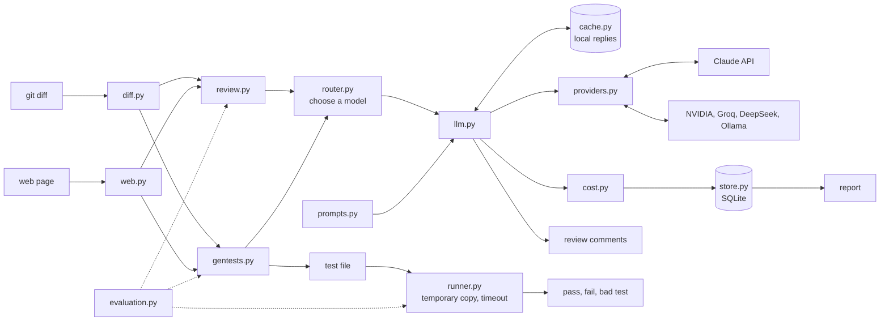

# PatchPilot

A Python CLI and GitHub Action that reviews a git diff with the Claude API (or NVIDIA, Groq,
DeepSeek or Ollama), generates pytest tests for the changed functions, runs them, and records the
tokens and cost of every request.

**Status:** the code is complete and tested against mocked APIs. A two-case trial has run against
the Groq API; the full evaluation has not been run, so there are no benchmark results.

## Architecture



| Module | What it does |
|---|---|
| `diff.py` | Parses `git diff` output into files, hunks and numbered lines |
| `review.py` | Asks for review comments and drops any on files that were not sent |
| `gentests.py` | Finds changed functions with `ast` and asks for tests |
| `prompts.py` | Versioned prompts (`v1`, `v2`) and the text form of a diff |
| `llm.py` | One request: size limit, local cache, validated JSON, logging |
| `providers.py` | The model API calls: timeout, up to 2 retries, reply token limit |
| `router.py` | Rules that pick the small or large model |
| `cache.py` | Local reply cache and prompt cache markers |
| `cost.py`, `store.py` | Price calculation and the SQLite request log |
| `runner.py` | Runs a test file on a temporary copy of the code and judges the results |
| `evaluation.py` | The seeded-bug evaluation |
| `web.py`, `static/` | The local web page |
| `cli.py`, `config.py` | Commands and settings |

## Install

Requires Python 3.11 or newer and git.

Windows (PowerShell):

```powershell
python -m venv .venv
.\.venv\Scripts\Activate.ps1
python -m pip install -e ".[dev]"
```

macOS or Linux:

```sh
python3 -m venv .venv
source .venv/bin/activate
python -m pip install -e ".[dev]"
```

Set `ANTHROPIC_API_KEY` as an environment variable, or copy `.env.example` to `.env` and fill it
in. Requests are billed to that key.

## Providers

Claude is the default. For another provider, set its key and either set
`PATCHPILOT_PROVIDER=<name>` or add `--provider <name>` to `review`, `gentests` or `eval`.

| Provider | Key variable | Large model | Small model | JSON reply |
|---|---|---|---|---|
| `anthropic` | `ANTHROPIC_API_KEY` | `claude-opus-5-5` | `claude-haiku-5-5` | Schema enforced by the API |
| `nvidia` | `NVIDIA_API_KEY` | `nvidia/nemotron-3-ultra-550b-a55b` | `nvidia/nemotron-3.5-lightning-30b-a3b` | Asked for in the prompt |
| `groq` | `GROQ_API_KEY` | `openai/gpt-oss-120b` | `openai/gpt-oss-20b` | JSON mode |
| `deepseek` | `DEEPSEEK_API_KEY` | `deepseek-v4-pro` | `deepseek-flash` | JSON mode |
| `ollama` (cloud) | `OLLAMA_API_KEY` | `gpt-oss:120b` | `gpt-oss:20b` | Asked for in the prompt |
| `ollama-local` | none | `gemma4:e4b` | `gemma4:e4b` | JSON mode |

Whatever the provider, every reply is validated against the expected structure. Prompt caching
markers, refusal fallback and the effort setting apply only to Claude. Costs are calculated from
the built-in Claude price table; for other providers they show as `unknown` unless you add prices
with `PATCHPILOT_PRICES`.

Defaults that differ between providers (override with `PATCHPILOT_MAX_TOKENS` and
`PATCHPILOT_REQUESTS_PER_MINUTE`):

- Reply limit: 16,000 tokens, but 4,096 for `groq` and 8,000 for `ollama-local`.
- Request spacing: 40 a minute for `nvidia` and 30 for `groq`, none for the others. Check the
  limits on your own account.

For `ollama-local`, install Ollama, run `ollama pull gemma4:e4b` (a download of several gigabytes)
and keep the server running. Local models can be slow, so you may need a larger
`PATCHPILOT_TIMEOUT_SECONDS`. A local server with a small context length can cut off long prompts.

Hosted providers receive your code. Read their terms before sending anything private.

## Usage

Save a diff with `--output`, which avoids shell redirection changing the file's encoding:

```sh
git diff main...HEAD --output=change.diff
```

```sh
patchpilot review change.diff                 # JSON comments: file, line, severity, message
patchpilot gentests change.diff               # writes patchpilot_tests.py without running it
patchpilot run patchpilot_tests.py            # runs it on a temporary copy of the code
patchpilot report                             # tokens and cost by feature and model
```

`--repo PATH` names the checkout that contains the change (default: the current folder).

**Bad tests.** A generated test can simply be wrong. If you have a checkout of code known to be
correct, `patchpilot run tests.py --good-repo PATH` marks tests that also fail there as
`bad test`. A test that passes there but fails on your change is marked `possible bug`. This only
helps for functions that exist in both versions.

### Web page

For people who prefer a browser: choose a provider and model, enter your own API key, and paste
Python code or a diff.

```sh
python -m pip install -e ".[web]"
```

```sh
patchpilot web
```

Then open <http://127.0.0.1:8000>.

- **Model:** leave it empty to let the routing rules choose, or type any model name.
- **API key:** a typed key is used for that request and not stored. If the field is empty, a key
  saved in your environment or `.env` is used.
- **Actions:** review code or a diff; generate tests for pasted Python code. The page never runs
  code.
- **Privacy:** only token counts and costs are logged. The reply cache is off for web requests.

It is a local tool, not a hosted service: it accepts connections from your computer only and has
no accounts or login. Putting it on the internet would need those, plus HTTPS and rate limits.

### Caching and routing

| Flag | Default | Effect |
|---|---|---|
| `--routing / --no-routing` | on | Small model for one file with at most 20 changed lines and no risky pattern; otherwise the large model |
| `--prompt-cache / --no-prompt-cache` | on | Marks the system prompt for Anthropic prompt caching |
| `--response-cache / --no-response-cache` | on | Answers an identical request from disk, free of charge |

Marking the diff itself for prompt caching is off by default (`PATCHPILOT_CACHE_FILE_CONTEXT`):
a diff that is sent once pays the cache-write premium and never reads it back.

### Settings

Every setting is an environment variable starting with `PATCHPILOT_`; [.env.example](.env.example)
lists them with their defaults. Claude prices are in [config.py](src/patchpilot/config.py), checked on 2026-11-26 against the
[pricing page](https://platform.claude.com/docs/en/about-claude/pricing).

If a safety check declines a request to a model that supports it, the API is asked to retry on
another model. The log records the model that answered and prices each attempt.

## Docker

```sh
docker build --tag patchpilot .
```

```sh
docker run --rm -e ANTHROPIC_API_KEY -v "${PWD}:/work" patchpilot review change.diff
```

On Linux, add `--user "$(id -u)"` so the container can write to the mounted folder.

## GitHub Action

[patchpilot.yml](.github/workflows/patchpilot.yml) reviews the Python changes in a pull request,
shows comments on the changed lines, generates and runs tests, and writes the results and cost to
the job summary. To switch it on, add the `ANTHROPIC_API_KEY` secret and set the repository
variable `PATCHPILOT_ENABLED` to `true`. It skips pull requests from forks.

## Evaluation

[eval/cases](eval/cases) holds 26 small functions, each with one seeded bug of a different type, a
correct version, and an oracle test that CI shows separates the two. Claude sees only the buggy
code, as a newly added file.

- **Caught by review:** a comment points at one of the case's bug lines.
- **Caught by tests:** a generated test passes on the correct code and fails on the buggy code.
- **Baseline:** large model, no routing, no caching. **Optimised:** routing and caching on, with
  an empty response cache at the start.

Run it from the repository root. It asks for confirmation, then sends up to 104 paid requests:

```sh
python eval/run_eval.py --readme README.md
```

Add `--limit 2` for a cheap trial, or `--no-tests` to skip test generation. The evaluation runs
code written by a model, so prefer the container. Pass the key as an environment variable and
keep no `.env` file in the mounted folder, because the tests can read mounted files:

```sh
docker run --rm -it -e ANTHROPIC_API_KEY -v "${PWD}:/work" patchpilot eval --readme README.md
```

For another provider, pass its key variable with `-e` and add `--provider <name>`. Costs then
show as `unknown`, so compare bugs caught, tokens and time.

Raw results are saved in `eval/results/`.

### Results

<!-- eval:start -->
No real evaluation has been run yet. Running the command above with `--readme README.md` replaces
this text with the measured table.
<!-- eval:end -->

## Safety

- API keys are read from the environment or `.env`, never logged and never passed to generated
  tests. Each key is sent only to its own provider.
- Prompts and code are written to disk only with `--debug` (to `patchpilot-debug.log`). The
  response cache stores model replies, which can quote code or contain generated tests.
- The diff is treated as untrusted: paths outside the repository are never read, and prompts tell
  the model to ignore instructions inside code. That instruction is not a guarantee.
- The web page refuses other host names and requests another website could send, so other sites
  cannot use your saved keys. Other programs and users on the same computer still can.
- Each provider's address is fixed in the code, so an environment variable cannot redirect a key.
- **The test runner is not a sandbox.** Generated tests run with your user's permissions and can
  use the network and read files. Read them first, or run them in a container.

## Limitations

- No benchmark results yet, only a two-case trial with Groq. The other providers have not returned
  a real reply, and the GitHub Action has not been exercised with a key.
- The web page is not in the Docker image, and its model list holds only each provider's defaults.
- Outside Claude, nothing forces the reply to match the expected structure, so some requests may
  fail validation. The prompts were written with Claude in mind and are not tuned for other models.
- `ollama-local` does not work from inside the Docker container, which cannot reach the host's
  `localhost`.
- Results from one provider say nothing about the other. The GitHub Action uses Claude.
- The evaluation is small and synthetic: one short file per case, one run, and model output varies
  between runs. A comment on a bug line counts even if it describes a different problem. False
  positives on correct code are not measured.
- Test generation covers top-level Python functions and methods only. The project's dependencies
  must be installed where PatchPilot runs.
- The system prompts are short and may be below the minimum size Anthropic caches, in which case
  prompt caching saves nothing. The evaluation's "Cached input" column shows what happened.
- Routing rules are hand-written heuristics.
- "Tokens saved" is an estimate (4 characters per token) and is negative when a diff is larger
  than the files, as for new files.
- Costs are calculated from the price table, not taken from an invoice. Failed requests have an
  unknown cost. After a refusal fallback, the declined attempt is priced even if Anthropic does
  not bill it.
- Merge (combined) diffs and copy detection are rejected. A diff cut off exactly between two hunks
  cannot be detected.
- The response cache never expires; delete `.patchpilot/cache` to clear it.

## How I use AI tools on this project and how I verify their output

Claude Code, Anthropic's coding agent, wrote the code, tests and documentation from my written
brief. I reviewed milestone 1 and approved the plan for milestone 2; after that it opened and
merged the pull requests itself once CI passed, without my review.

Automated checks on its output:

- Ruff and the test suite run on every pull request. API tests replace only the network layer, so
  the real SDK builds each request and handles retries.
- The diff parser is tested on diffs produced by real git, and its line numbers are compared with
  the actual files.
- Every seeded bug has an oracle test proving the bug exists.
- Benchmark numbers come only from the evaluation command; none are written by hand.

My own review (not done yet):

- [ ] Read each module and explain it without help
- [ ] Run the real evaluation and check a sample of "caught" results by hand
- [ ] Try the GitHub Action on a test pull request

## Development

```sh
ruff check .
ruff format --check .
pytest
```
